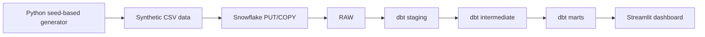

# WealthOps Analytics

**Portfolio project** — dbt Core + Snowflake + Python + SQL + synthetic wealth-management data.

This repository is a **learning/portfolio implementation**, not a production wealth-management system and not affiliated with Yomoni or any financial provider. It uses no real clients.

## Objective

Model reliable finance analytics for a fictional investment platform offering insurance-based savings, PEA and PER. Synthetic customers, accounts, cashflows, valuations, fees and partner statements feed analytics marts.

### Architecture



### Core technical deliverables

- Six synthetic RAW datasets, six typed staging views, four business-rule intermediate models.
- Two dimensions, three fact tables and four analytics marts, including AUM, net inflows and partner reconciliation.
- Generic dbt schema tests plus SQL business-rule tests.
- Incremental daily valuation model with update-based lookback; account-status snapshot.
- Python regression tests, YAML validation, offline GitHub Actions.
- Three-page Streamlit dashboard backed by Snowflake marts.

## Local setup (Python 3.12 recommended)

```bash
python -m venv .venv
# macOS/Linux: source .venv/bin/activate
# Windows PowerShell: .venv\Scripts\Activate.ps1
python -m pip install -r requirements.txt
python -m pytest -q
python -m scripts.generate_data --profile demo --out data/generated
python -m scripts.validate_yaml
```

### Snowflake Trial

1. Create a Snowflake Trial account. Only synthetic datasets are used.
2. In a Snowflake worksheet execute [bootstrap SQL](sql/bootstrap.sql), under a role authorized to create a database and warehouse. Warehouse X-SMALL, auto-suspend 60s.
3. Copy `.env.example` to `.env` and set your local account/user/warehouse/role. Never commit `.env`.
4. Copy `profiles.example.yml` to `~/.dbt/profiles.yml`. dbt reads variables from your environment; load `.env` into your shell first, or set the values in the local untracked profile.
5. Run `python -m scripts.load_snowflake --dir data/generated`.
6. Run `dbt debug` and `dbt build` from the repository root.
7. Run `dbt snapshot` to take the initial snapshot.
8. Run `dbt docs generate` and `dbt docs serve`.
9. Start dashboard: `streamlit run dashboard/app.py`.

**Warehouse and model tests require real Snowflake access; CI currently validates only offline Python and YAML.** Do not claim dbt cloud tests have passed before running them.

### Load and cost caveats

The loader uses `CREATE OR REPLACE TABLE`, `PUT`, `COPY INTO`; use in the dedicated training database only because it intentionally replaces RAW data. Only run the `--profile full` generator after the smaller demo dataset succeeds. Model `fct_account_valuations_daily` incrementality and account snapshots should be validated against a live Trial account before treating them as operationally reliable.

### Business rules & limitations

Definitions are documented in [business rules](docs/business_rules.md). Assumptions: EUR only, synthetic valuations are independent of transactions, no profitability or investment-return claims. AUM is additive across accounts on the same date but not across dates. Future work: robust changed-record ingestion, stronger late-arriving-correction demonstrations, dbt unit tests, purpose-built anomaly fixture and semantic-layer/agentic analytics.

