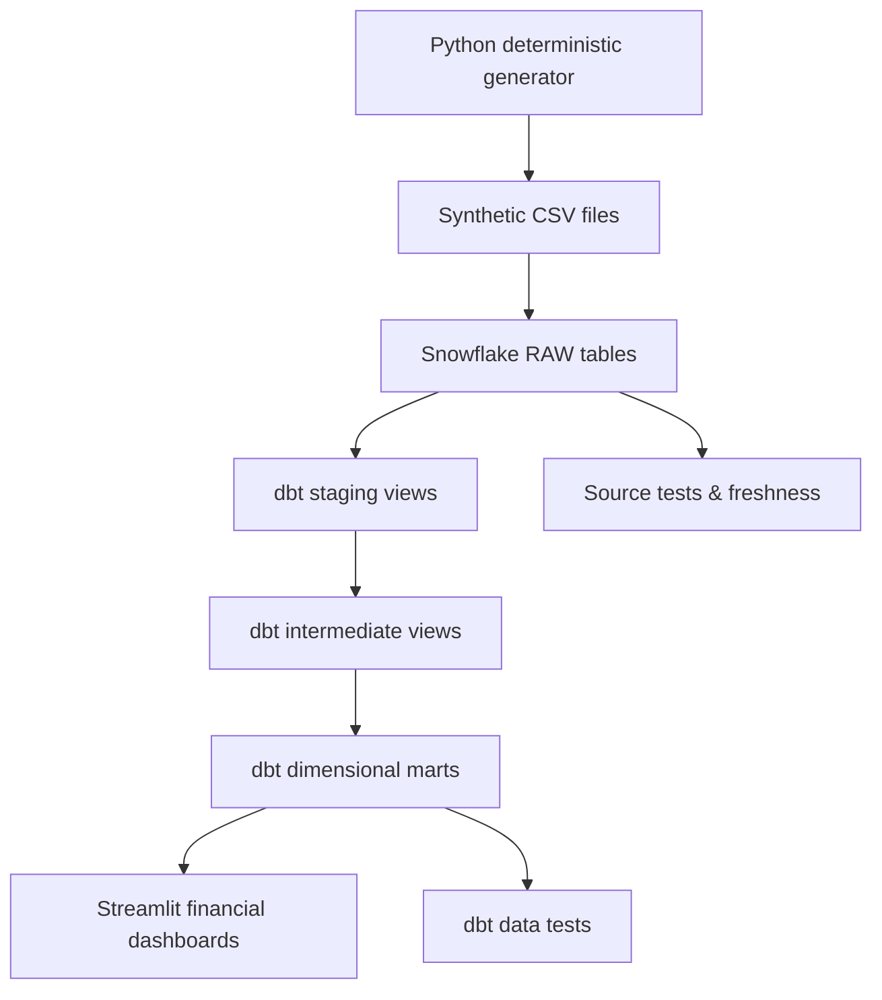

# Architecture

## Decisions
- Snowflake + dbt Core resemble a real modern analytics-engineering stack, suitable for a personal trial account.
- RAW source reset on demo load is intentional. No claims of production ingestion robustness.
- Staging models normalize fields; intermediate models encode rules; marts expose dimensions, facts and KPIs.
- Development warehouse is X-SMALL with 60-second auto-suspend.
- All data are generated, not collected from any fintech or exchange.
- Do not use this dashboard to make investment decisions.

## Security
Credentials are environment variables or local ~/.dbt/profiles.yml; never commit them. GitHub CI performs offline checks unless separate integration secrets are supplied.

